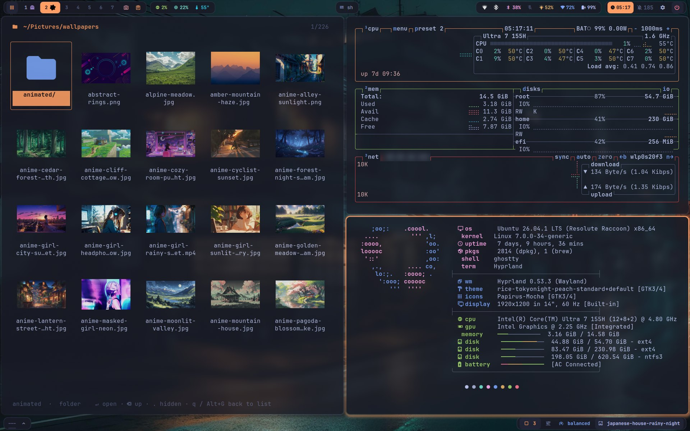
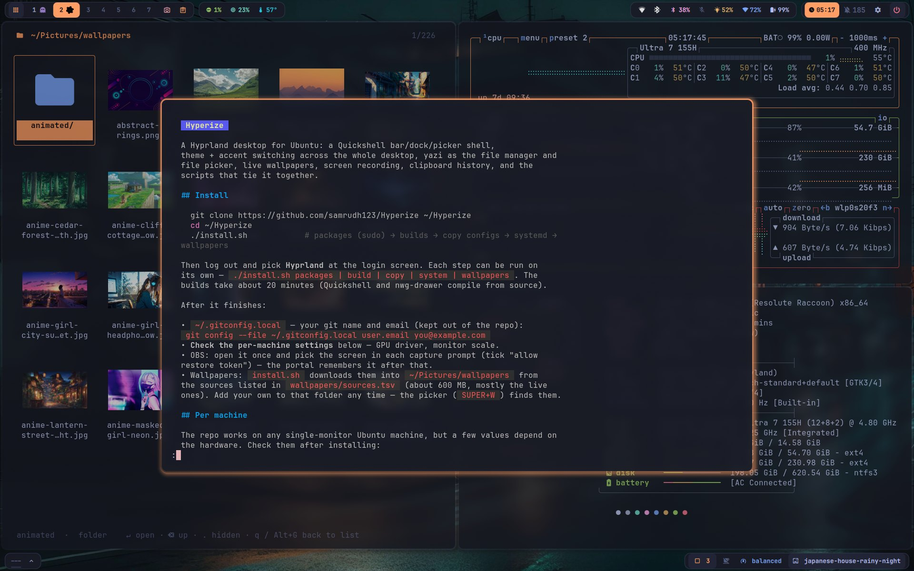
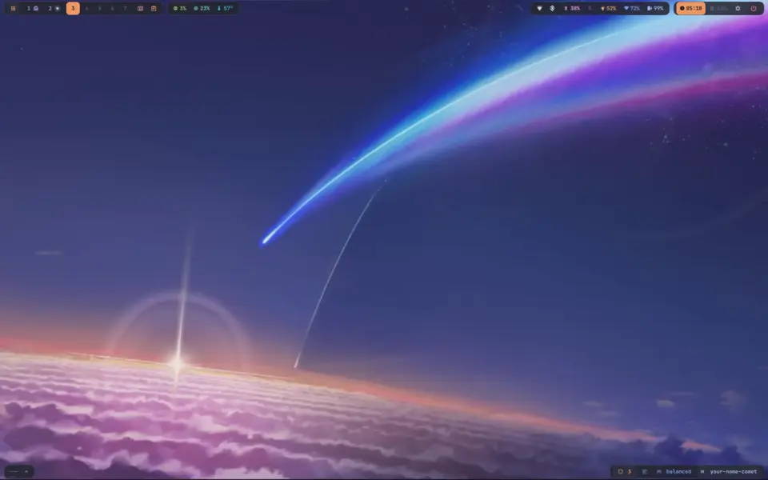
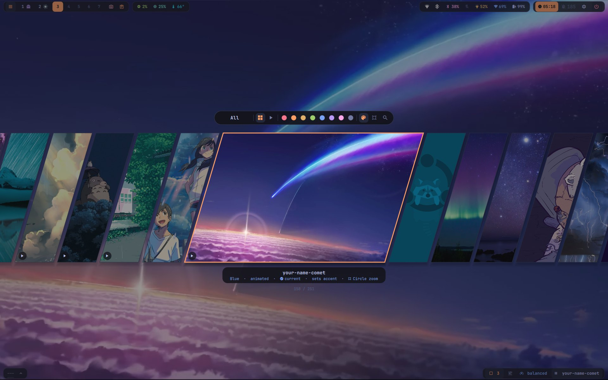
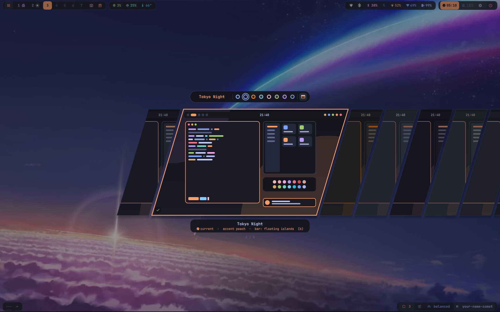
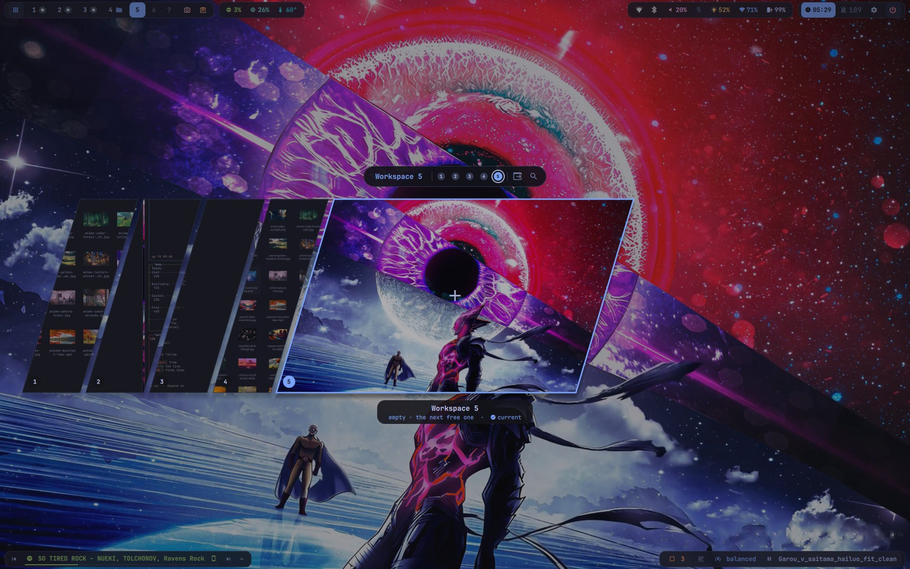

# Hyperize

A Hyprland desktop for Ubuntu: a Quickshell bar/dock/picker shell,
theme + accent switching across the whole desktop, yazi as the file manager and
file picker, live wallpapers, screen recording, clipboard history, and the
scripts that tie it together.

## Screenshots

[](screenshots/latest_rice_look.mp4)
<sub>Floating-island top and bottom bars over a live wallpaper (click for the full-quality video).</sub>

| | |
|:---:|:---:|
|  |  |
| Tiled apps — yazi's grid view (`Alt+G`), btop, fastfetch | The scratchpad (`SUPER+S`) floating over a workspace |
|  |  |
| A live (video) wallpaper playing | The wallpaper picker (`SUPER+W`) — colour filters, live previews |
|  |  |
| The theme picker (`SUPER+T`) — 8 themes across the whole desktop | The workspace picker (`SUPER+Tab`) — live previews of every workspace, over a Garou vs Saitama live wallpaper |

## Install

```bash
git clone https://github.com/samrudh123/Hyperize ~/Hyperize
cd ~/Hyperize
./install.sh            # packages (sudo) → builds → copy configs → systemd → wallpapers
```

Then log out and pick **Hyprland** at the login screen. Each step can be run on
its own — `./install.sh packages | build | copy | system | wallpapers`. The
builds take about 20 minutes (Quickshell and nwg-drawer compile from source).

After it finishes:

- `~/.gitconfig.local` — your git name and email (kept out of the repo):
  `git config --file ~/.gitconfig.local user.email you@example.com`
- **Check the per-machine settings** below — GPU driver, monitor scale.
- OBS: open it once and pick the screen in each capture prompt (tick "allow
  restore token") — the portal remembers it after that.
- Wallpapers: `install.sh` downloads them into `~/Pictures/wallpapers` from
  the sources listed in `wallpapers/sources.tsv` (about 600 MB, mostly the live
  ones). Add your own to that folder any time — the picker (`SUPER+W`) finds them.

## Per machine

The repo works on any single-monitor Ubuntu machine, but a few values depend on
the hardware. Check them after installing:

| What | Where | Default |
|---|---|---|
| VA-API driver | `LIBVA_DRIVER_NAME` in `~/.config/hypr/hyprland.conf` | `iHD` (Intel). AMD: `radeonsi`. NVIDIA: remove the line |
| Monitor + scale | the `monitor =` line in `hyprland.conf` | `,preferred,auto,1` — raise the scale on a high-DPI panel |
| Dock pins | right-click an app in the dock → Pin | per machine, starts empty |

Everything else adapts on its own: the bars span the screen width, the dock
centres itself, disks and trash appear in the dock from the actual mounts. The
long-form notes (`Hyprland_CLAUDE.md`, "Adapt per machine") cover the details.

## Layout

Every top-level directory is a package that mirrors `$HOME`:
`hypr/.config/hypr/…` is installed as `~/.config/hypr/…`. `install.sh copy`
**copies** the files into your home, so your configs are yours to change and a `git pull` never touches them by itself.
Files of yours that a copy would overwrite are moved to
`~/.dotfiles-backup/<date>/` first.

| Package | What |
|---|---|
| `hypr` | Hyprland, hyprlock/hypridle, every helper script, the theme engine (`set-theme.sh`, `set-accent.sh`, `rice-theme.py`), patches for the nwg tools |
| `quickshell` | top bar, bottom bar, dock, wallpaper / workspace / theme pickers, clipboard and recorder |
| `yazi` | file manager config, plugins, grid view (`Alt+G`) |
| `ghostty` `mako` `fuzzel` `tmux` `bat` `btop` `glow` `fastfetch` `zathura` | app configs |
| `vscode-pdf-zathura` | VS Code extension: PDFs open in a zathura-style viewer themed from `zathurarc` (`copy` builds and installs it); `firefox/` is the same viewer as a Firefox extension (sign the xpi on AMO, see its README) |
| `nwg` `waybar` | the app grid, and the old waybar setup (kept as a fallback) |
| `portals` | routes file dialogs to yazi, screen sharing to the Hyprland portal |
| `zsh` `bash` `git` | shell, prompt (starship), git (identity in `~/.gitconfig.local`) |
| `dl-popup` `aria2` | the download popup, its Firefox extension + native host (`.local/share/dl-popup`, sign the xpi on AMO, see its README) and its aria2 daemon hooks |
| `systemd` `environment` `applications` `bin` `gtk` `vscode` | user units, env, `.desktop` overrides, small scripts, GTK, VS Code settings |
| `notes` | `Hyprland_CLAUDE.md` — the long-form notes: how it all works, landmines (not copied; read it here) |
| `extras/` | seeded **once** on install, never overwritten later: OBS profile/scenes/theme, spicetify, aria2.conf, dl-popup config — apps rewrite these files themselves, or they hold a per-machine secret |
| `build/` | build scripts for what Ubuntu doesn't package |
| `packages/apt.txt` | apt packages |
| `wallpapers/` | `sources.tsv` (file → URL) and `fetch.sh` |

## Updating

```bash
cd ~/Hyperize
git pull
./install.sh copy       # bring your configs up to the new version
```

Only files that changed are copied; anything you had edited yourself is backed
up to `~/.dotfiles-backup/<date>/` before being replaced, so you can diff or
restore it. Skip the `copy` to stay on what you have.
