# Hyperize

A Hyprland desktop for Ubuntu: a Quickshell bar/dock/panel shell, theme +
accent switching across the whole desktop (now with **seasonal themes**), yazi
as the file manager and file picker, live wallpapers, a tiling Zen browser,
screen recording, tasks with deadlines, and the scripts that tie it together.

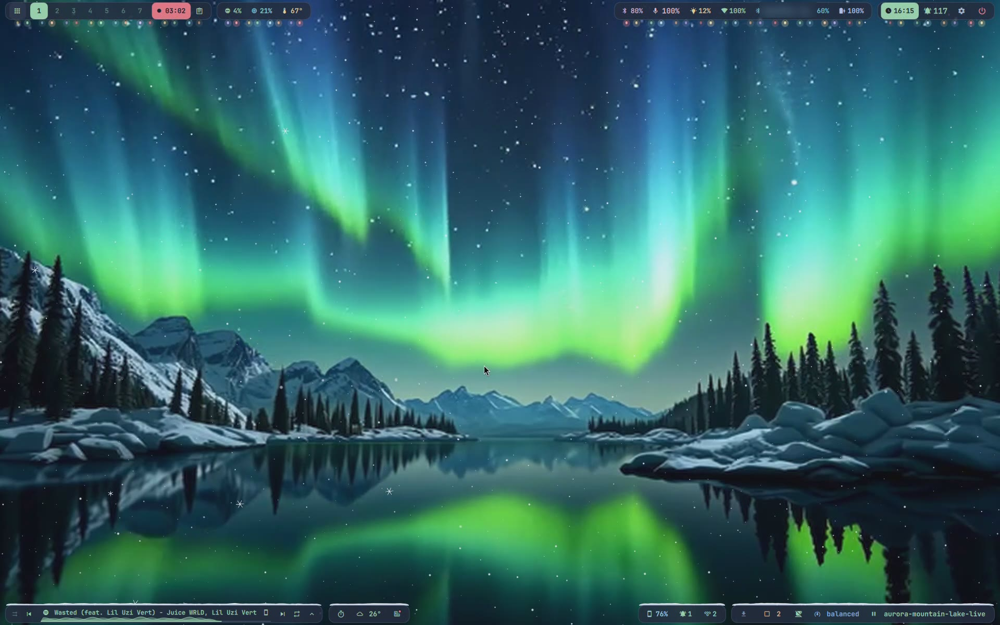
<sub>Winter Night — snowfall over the live aurora wallpaper, fairy lights strung under the top bar's islands.</sub>

**Contents:** [What's New!!](#whats-new) · [Features](#features) ·
[Screenshots](#screenshots) · [Install](#install) · [Per machine](#per-machine) ·
[Layout](#layout) · [Updating](#updating)

---

## What's New!!

### ❄️ Winter — the first seasonal theme <sub>(Nov 2026)</sub>

Two new themes in the theme picker (`SUPER+SHIFT+T`): **Winter Night** (dark)
and **Winter Day** (its light flavour, `m` in the picker). Besides an icy
palette for every themed app, they bring the season onto the desktop itself:

| | |
|:---:|:---:|
| 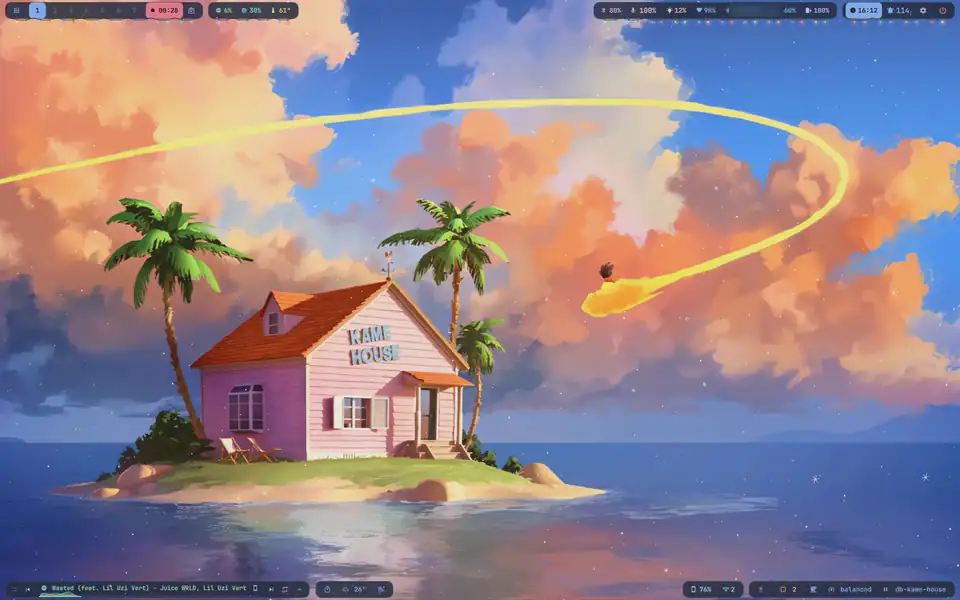 | 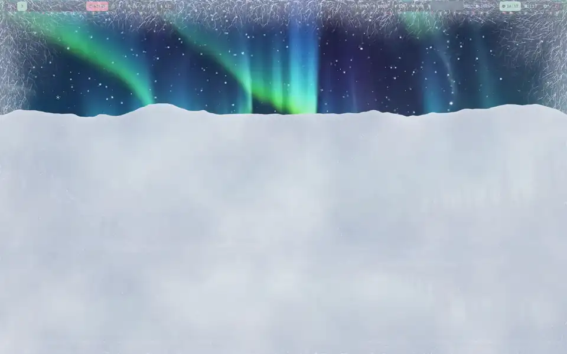 |
| Picking Winter Night — the wallpaper changes with a circle reveal | Snowed in while idle — hold `Shift` and draw in the snow |
| 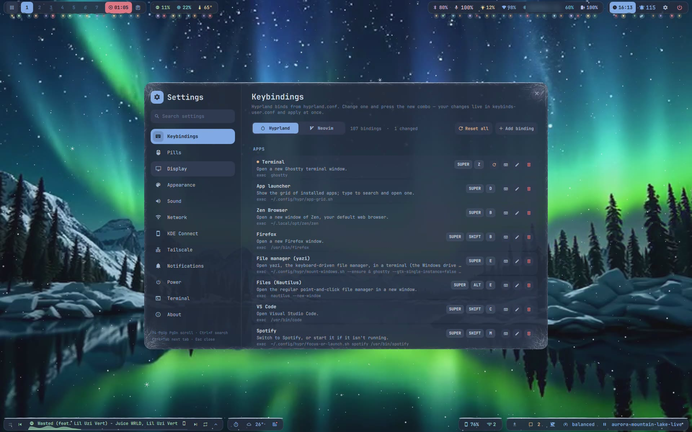 | 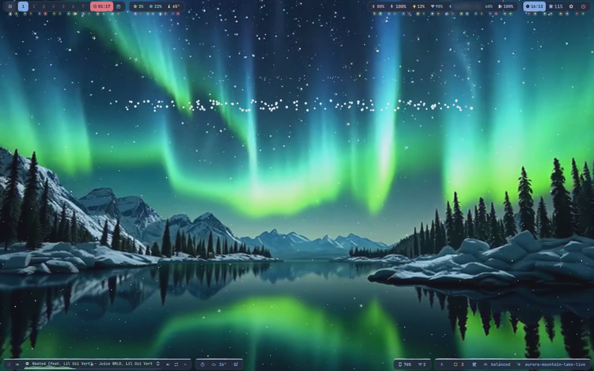 |
| Snow settles on top of panels; frost creeps into their corners | Close a panel and the snow on it falls off |
| 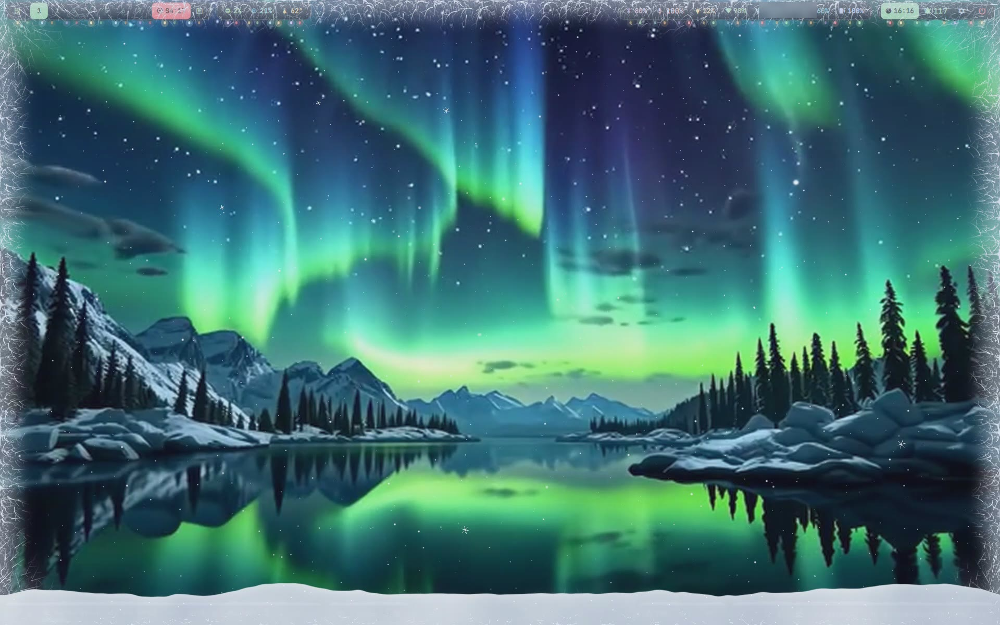 | 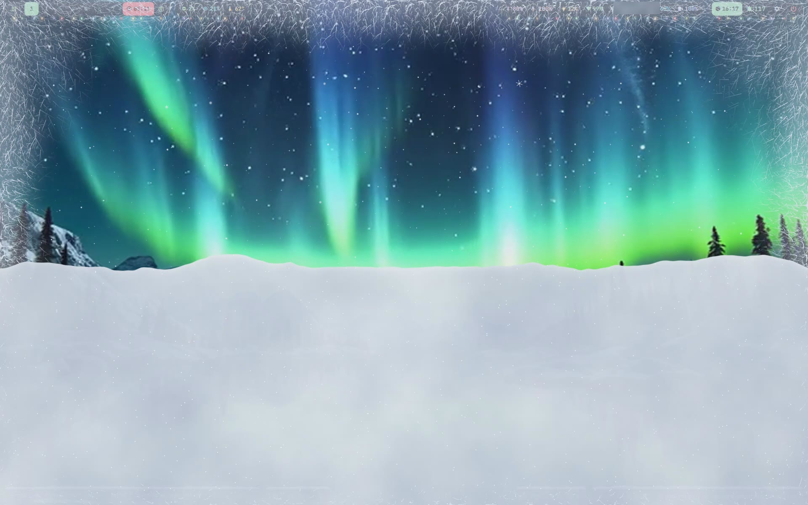 |
| Leave it alone: the screen frosts over… | …and fills with snow. Move the mouse to wipe it away |

- **Snowfall** — flakes drift down over the desktop, gusting now and then, and
  swerve around the mouse pointer. Light / Normal / Heavy.
- **Snow settles** on the tops of windows, bar panels, pickers and the bottom
  bar's islands — and falls off in clumps when they move, close, collapse or
  leave with their workspace.
- **Snowed in when idle** — the screen frosts over and slowly fills with snow;
  moving the mouse wipes it away. **Hold `Shift`** to move without wiping
  while the snow keeps piling up: draw in it. Drawings melt away on their own
  after a while. Never while a video is playing.
- **Frosted panels** (ice feathers in the corners) and twinkling **fairy
  lights** along the top bar.
- **Seasonal wallpaper** — a live aurora over a snowy lake (Night) or a lone
  tree in snow (Day). Your own wallpaper comes back when you leave the season.
- Every effect has its own switch in **Settings › Appearance › Season**
  (`SUPER+I`), plus a one-click **Back to &lt;your previous theme&gt;**.
  Snowfall stops by itself on low battery and under fullscreen windows.
- Built from GLSL shaders (`quickshell/shaders/snow*.frag`, `frost.frag`) and
  a small `SeasonState` singleton, so other seasons can reuse the same pieces.
  Preview the snow-in without waiting: `qs ipc call winter snowin`.
- The shell now runs under `qs-run.sh`, which restarts Quickshell if it ever
  crashes.

### Earlier this month

- **Zen as a tiling browser** <sub>(Nov 20–21)</sub> — a tab or split view is a
  *workspace*: `Ctrl+T` tiles a new page where the cursor is, `Alt+1..0` jumps
  between workspaces, `Alt+Tab` opens a workspace picker, `Alt+arrows` /
  `Alt+Shift+arrows` / `Alt+Ctrl+arrows` focus, move and resize tiles, with
  Hyprland's own animations. Starts on the workspace you used last.
- **Hide both bars** with `SUPER+SHIFT+A` <sub>(Nov 20)</sub>; opening any panel
  from a keybind brings its bar back.
- **Neovim** config <sub>(Nov 20)</sub> — colourscheme follows the accent live,
  LSP via mason, treesitter, fzf-lua, blink.cmp; `Space f k` searches every
  keymap; `` Ctrl+` `` toggles code ↔ terminal.
- **Keyboard everywhere** in panels <sub>(Nov 8–20)</sub> — `Tab` jumps section
  to section, arrows move inside one (and wrap), `Ctrl+←/→` the neighbouring
  pill's panel, `Ctrl+↑/↓` the other bar; the focus ring takes the section's
  colour. Arrow-key navigation in text boxes.
- **Light mode** <sub>(Nov 7)</sub> — Settings › Appearance › Mode flips the
  whole desktop, VS Code and libadwaita apps included; every theme has a light
  flavour (with a small "are you sure?" gate before leaving the dark side).
- **Pills you can configure** <sub>(Nov 4–8)</sub> — every pill's left / right /
  middle click and scroll is set in Settings › Pills; the bottom-bar pill layout
  and the number of workspaces shown are configurable; a shared dropdown menu.
- **Terminal greeting** <sub>(Nov 1–5)</sub> — logo + a fortune / cowsay quote in
  the accent colour, from fortune or 12 collections (programming, jokes, dad
  jokes, memes, shower thoughts, …), picked in Settings › Terminal.
- **yazi** <sub>(Nov 3)</sub> — `Shift+←/→` scrolls the preview sideways;
  `Shift+Enter` = "Open with" any installed app, remembering your choice.
- **Remote accent** <sub>(Nov 4)</sub> — terminals over SSH take this machine's
  accent.
- **Battery saver** <sub>(Nov 1)</sub> — at ≤20 % the live wallpaper pauses and
  the heavier effects stop.

---

## Features

**The shell (Quickshell)**
- Floating-island (or classic) top and bottom bars made of *pills* — CPU / RAM /
  temperature, audio, network, Bluetooth, brightness + night light, battery,
  clipboard, capture, downloads, weather, news, focus timer, tasks, media
  player with a spectrum visualizer — each opening its own panel.
- Panels: Settings (`SUPER+I`) — keybindings editor (press the new combo),
  display, appearance, sound, network, notifications, power, terminal greeting;
  sound mixer, Wi-Fi, notification centre (`SUPER+N`), music with a 10-band
  equalizer and synced lyrics, players deck (`SUPER+M`), news by category with
  FREE / LIMITED / PAID badges, weather, displays (duplicate / extend).
- A dock with pins, live window lists and drag-to-reorder (`SUPER+A`).

**Themes and pickers**
- 9 themes — Catppuccin Mocha, Tokyo Night, Gruvbox Dark, Nord, Rosé Pine,
  Everforest, Dracula, Kanagawa, Winter — each with a light flavour, recolouring
  everything: bars, borders, lock screen, notifications, terminals, yazi, btop,
  bat, Neovim, VS Code, Zen, GTK, zathura, LibreOffice, Discord.
- Any accent colour (`SUPER+ALT+C`), or let it follow the wallpaper.
- Wallpaper picker (`SUPER+W`) — colour filters, live (video) wallpapers, a
  dozen transitions (circle zoom, iris, wave, pixelate, …); a lock-screen picker
  (`SUPER+SHIFT+W`); a workspace picker with live miniatures (`SUPER+Tab`).

**Windows and workspaces**
- `SUPER+arrows` also moves focus into floating popups; per-app window
  transparency with `SUPER+SHIFT+scroll`; a blur toggle; a scratchpad
  (`SUPER+S`); 3-finger swipes; external monitors remembered per screen.

**Apps, all themed**
- Ghostty + zsh/starship, yazi (also the file picker for every app's open/save
  dialog, with a thumbnail grid view), Neovim, Zen (tiling workspaces, live
  accent), zathura for PDFs (also inside VS Code and Zen), swayimg, btop,
  Kdenlive, OBS.

**Getting things done**
- Tasks with deadlines (`@fri 5pm`, `@every mon`), priorities, reminders and a
  calendar with deadline dots (`SUPER+T`); a focus timer that mutes
  notifications; daily logs in `~/notes`.
- Screenshots and recordings from one capture panel (`SUPER+R`) — region /
  window / screen, audio only, OBS — each followed by a "keep it, and where?"
  prompt.
- A download popup that catches browser downloads and hands them to aria2.
- Clipboard history with image previews (`SUPER+SHIFT+V`).

The full key list is in [`CHEATSHEET.md`](hypr/.config/hypr/CHEATSHEET.md).

---

## Screenshots

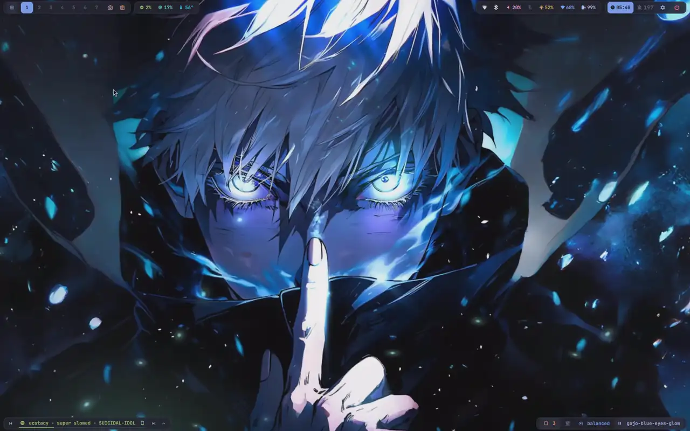
<sub>Floating-island top and bottom bars over a live wallpaper.</sub>

| | |
|:---:|:---:|
| 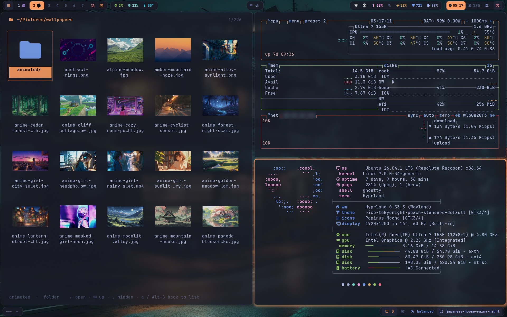 | 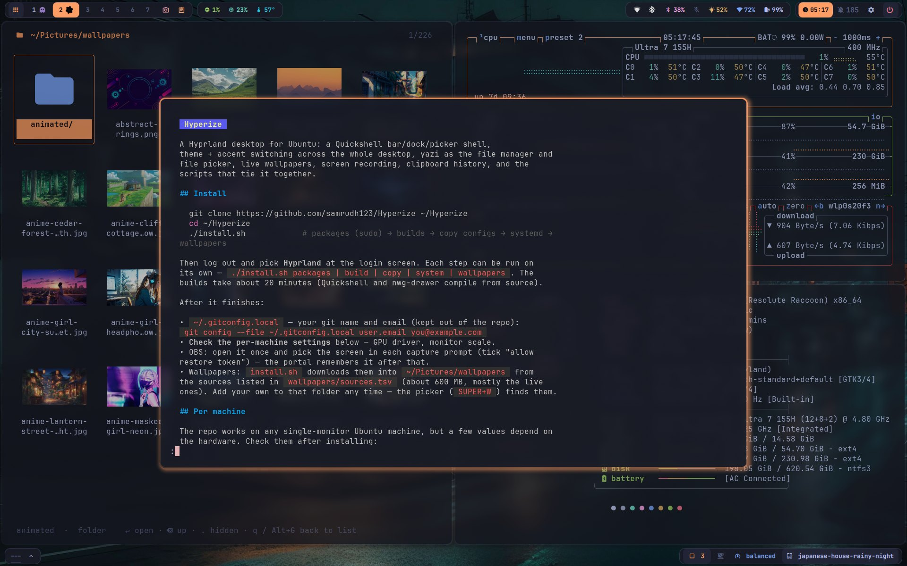 |
| Tiled apps — yazi's grid view (`Alt+G`), btop, fastfetch | The scratchpad (`SUPER+S`) floating over a workspace |
| 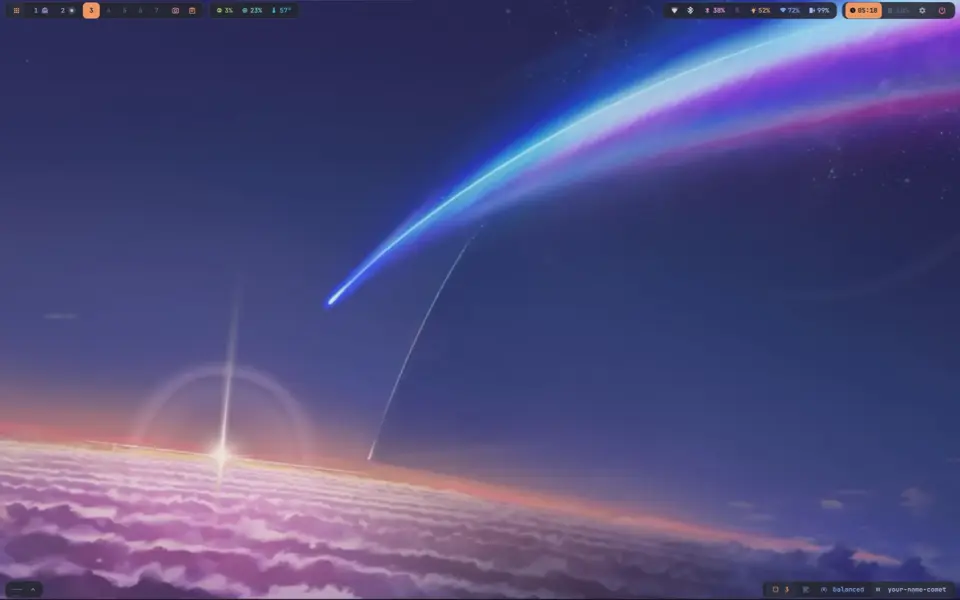 | 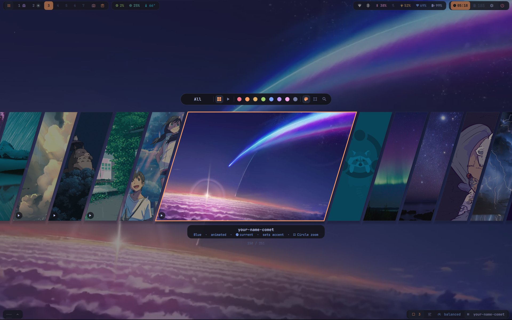 |
| A live (video) wallpaper playing | The wallpaper picker (`SUPER+W`) — colour filters, live previews |
| 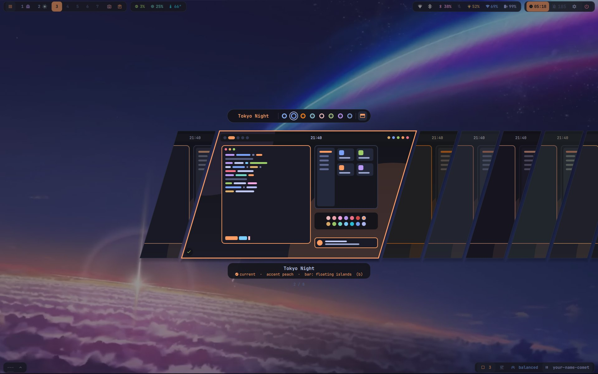 | 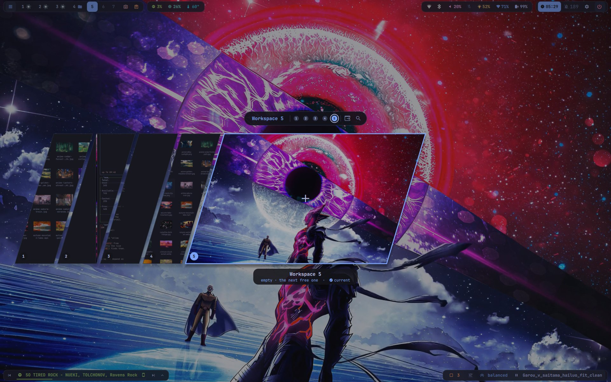 |
| The theme picker (`SUPER+SHIFT+T`) — every theme across the whole desktop | The workspace picker (`SUPER+Tab`) — live previews of every workspace, over a Garou vs Saitama live wallpaper |
| 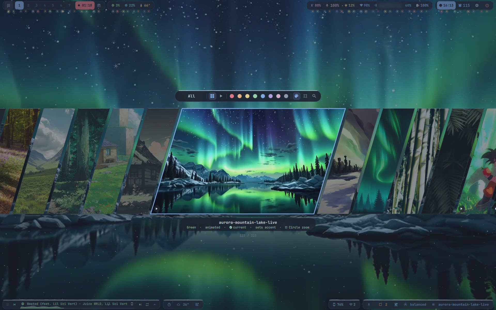 | |
| The wallpaper picker in Winter Night | |

## Install

```bash
git clone https://github.com/samrudh123/Hyperize ~/Hyperize
cd ~/Hyperize
./install.sh            # packages (sudo) → builds → copy configs → systemd → wallpapers
```

Then log out and pick **Hyprland** at the login screen. Each step can be run on
its own — `./install.sh packages | build | copy | system | wallpapers`. The
builds take about 20 minutes (Quickshell and nwg-drawer compile from source).

After it finishes:

- `~/.gitconfig.local` — your git name and email (kept out of the repo):
  `git config --file ~/.gitconfig.local user.email you@example.com`
- **Check the per-machine settings** below — GPU driver, monitor scale.
- Zen Browser is the browser (`SUPER+B`, the dock, "Open YouTube"; Firefox-based,
  `build/zen.sh` installs it into `~/.local/opt/zen`), and the only one the
  rice themes and builds extensions for. Make it the system default with
  `xdg-settings set default-web-browser zen.desktop`. Coming from Firefox: with
  both closed, `zen-import-firefox` copies your Firefox profile into Zen —
  bookmarks, history, cookies, site data, passwords, extensions — and themes
  Zen's chrome with the accent. The rice's own extensions are then installed
  unsigned (no AMO signing): re-run their `build.sh`, or
  `zen-install-xpi file.xpi`. Their native hosts live in
  `~/.mozilla/native-messaging-hosts`, which Zen reads.
- OBS: open it once and pick the screen in each capture prompt (tick "allow
  restore token") — the portal remembers it after that.
- Wallpapers: `install.sh` downloads them into `~/Pictures/wallpapers` from
  the sources listed in `wallpapers/sources.tsv` (about 600 MB, mostly the live
  ones). Add your own to that folder any time — the picker (`SUPER+W`) finds them.

## Per machine

The repo works on any Ubuntu machine, but a few values depend on the hardware.
Check them after installing:

| What | Where | Default |
|---|---|---|
| VA-API driver | `LIBVA_DRIVER_NAME` in `~/.config/hypr/hyprland.conf` | `iHD` (Intel). AMD: `radeonsi`. NVIDIA: remove the line |
| Monitor + scale | the `monitor =` line in `hyprland.conf` | `,preferred,auto,1` — raise the scale on a high-DPI panel |
| Dock pins | right-click an app in the dock → Pin | per machine, starts empty |

Everything else adapts on its own: the bars span the screen width, the dock
centres itself, disks and trash appear in the dock from the actual mounts, and
an external monitor gets both bars (duplicate / extend from the display pill,
remembered per monitor). The long-form notes (`Hyprland_CLAUDE.md`, "Adapt per
machine") cover the details.

## Layout

Every top-level directory is a package that mirrors `$HOME`:
`hypr/.config/hypr/…` is installed as `~/.config/hypr/…`. `install.sh copy`
**copies** the files into your home, so your configs are yours to change and a `git pull` never touches them by itself.
Files of yours that a copy would overwrite are moved to
`~/.dotfiles-backup/<date>/` first.

| Package | What |
|---|---|
| `hypr` | Hyprland, hyprlock/hypridle, every helper script, the theme engine (`set-theme.sh`, `set-accent.sh`, `rice-theme.py`), patches for the nwg tools |
| `quickshell` | top bar, bottom bar, dock, panels and settings, wallpaper / workspace / theme pickers, clipboard and recorder, the seasonal effects (`SeasonState.qml`, `Winter*.qml`, `shaders/`) |
| `yazi` | file manager config, plugins, grid view (`Alt+G`) |
| `ghostty` `mako` `fuzzel` `tmux` `bat` `btop` `glow` `fastfetch` `zathura` `swayimg` `nvim` | app configs |
| `pipewire` | `rice-eq.conf`: the music panel's 10-band equalizer (a WirePlumber smart filter, `rice-eq.service`) |
| `zen` | Zen's live theme + accent and tiling workspaces (an autoconfig script, `build/zen.sh` installs it) — see `zen/.config/zen-rice/README.md` |
| `firefox-accent` | the old Firefox-only live-accent extension; no longer installed (Zen has `zen` instead) |
| `video-fullscreen` | Zen + Brave extension and native host (`hypr/video-fullscreen.py`): only a video put fullscreen with the player's button is drawn opaque, F11 / SUPER+F keep the transparency; YouTube Music via MPRIS (`copy` builds it, installs it into Zen and registers the host; load `chromium/` unpacked in Brave, see its README) |
| `vscode-pdf-zathura` | VS Code extension: PDFs open in a zathura-style viewer themed from `zathurarc` (`copy` builds and installs it); `firefox/` is the same viewer as a Zen extension (its `build.sh` installs it into Zen) |
| `nwg` `waybar` | the app grid, and the old waybar setup (kept as a fallback) |
| `portals` | routes file dialogs to yazi, screen sharing to the Hyprland portal |
| `zsh` `bash` `git` | shell, prompt (starship), git (identity in `~/.gitconfig.local`) |
| `mpris-position` | Zen extension + native host: every YouTube / YouTube Music tab is its own MPRIS player with reliable position, shuffle and repeat — the bar's laptop pill and media menu rely on it (`copy` builds it, installs it into Zen and registers the host) |
| `media-title-sync` | browser extension, mainly for Firefox on the phone: keeps the media notification's title current on streaming sites that switch episodes without reloading (not installed by `install.sh`; see its README) |
| `dl-popup` `aria2` | the download popup, its Zen extension + native host (`.local/share/dl-popup`, `build.sh` installs it into Zen) and its aria2 daemon hooks |
| `systemd` `environment` `applications` `bin` `gtk` `vscode` | user units, env, `.desktop` overrides, small scripts, GTK, VS Code settings |
| `notes` | `Hyprland_CLAUDE.md` — the long-form notes: how it all works, landmines (not copied; read it here) |
| `extras/` | seeded **once** on install, never overwritten later: OBS profile/scenes/theme, spicetify, aria2.conf, dl-popup config — apps rewrite these files themselves, or they hold a per-machine secret |
| `build/` | build scripts for what Ubuntu doesn't package |
| `packages/apt.txt` | apt packages |
| `wallpapers/` | `sources.tsv` (file → URL) and `fetch.sh` |
| `screenshots/` | the images in this README |

## Updating

```bash
cd ~/Hyperize
git pull
./install.sh copy       # bring your configs up to the new version
```

Only files that changed are copied; anything you had edited yourself is backed
up to `~/.dotfiles-backup/<date>/` before being replaced, so you can diff or
restore it. Skip the `copy` to stay on what you have.
